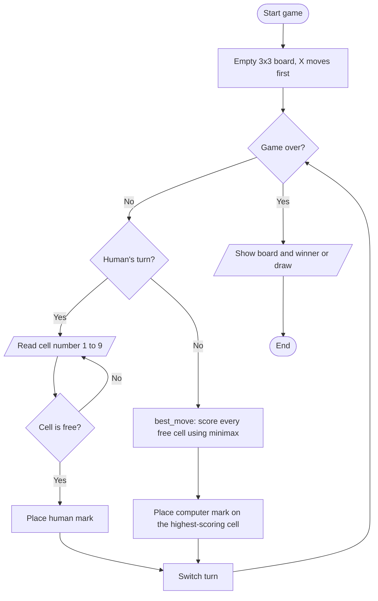
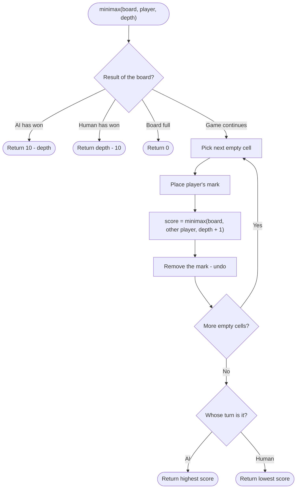

# Case Study 7: Tic-Tac-Toe with an Unbeatable Computer Player (Minimax)

> **Files:** [`tictactoe_ai.py`](tictactoe_ai.py) · [`test_tictactoe_ai.py`](test_tictactoe_ai.py) · [`output.txt`](output.txt)

## 1. Problem Statement

Develop a two-player Tic-Tac-Toe game in which one player is a human and the other is the computer. The computer must play perfectly: it must take a win when available, block the opponent's winning move and never lose a game. A human can at best draw.

## 2. Objectives

- Represent a game board with a list and detect win/draw states using a list of winning lines.
- Understand and implement the Minimax algorithm using recursion.
- Use scoring with depth so that quicker wins are preferred.
- Verify correctness by exhaustively testing every possible human move.

## 3. Assumptions

- The board has 9 cells numbered 1-9 (stored as indexes 0-8); X always moves first.
- The human chooses X or O at the start; the computer plays the other symbol.
- On an empty board the computer plays the centre cell (it is optimal and avoids a long search).
- Input is typed in the terminal; invalid or occupied cells are rejected and asked again.

## 4. Algorithm

1. Start with an empty 3x3 board and X to move.
2. While the game is not over: if it is the human's turn read a free cell (1-9) and place the mark.
3. If it is the computer's turn call `best_move`, which tries every empty cell and evaluates it with `minimax`.
4. **minimax(board, player, depth):** if the AI has won return 10 - depth; if the human has won return depth - 10; if the board is full return 0.
5. Otherwise try every empty cell: place the mark, call minimax for the other player with depth + 1, remove the mark.
6. When it is the AI's turn take the maximum of the scores, otherwise take the minimum.
7. `best_move` chooses the cell with the highest score. Switch turns and repeat.
8. When the game ends, show the board and announce the winner or a draw. Stop.

## 5. Pseudocode

```text
FUNCTION minimax(board, player, depth)
    result <- winner(board)
    IF result = AI THEN RETURN 10 - depth
    IF result = HUMAN THEN RETURN depth - 10
    IF result = "Draw" THEN RETURN 0
    scores <- empty list
    FOR EACH empty cell
        board[cell] <- player
        APPEND minimax(board, other(player), depth + 1) TO scores
        board[cell] <- empty                      // undo the move
    IF player = AI THEN RETURN MAX(scores) ELSE RETURN MIN(scores)
END FUNCTION

FUNCTION best_move(board, AI)
    IF board is empty THEN RETURN centre cell
    best_score <- none
    FOR EACH empty cell
        board[cell] <- AI
        score <- minimax(board, other(AI), 1)
        board[cell] <- empty
        IF best_score is none OR score > best_score THEN best_cell <- cell; best_score <- score
    RETURN best_cell
END FUNCTION
```

## 6. Flowchart

### 6.1 Game loop



### 6.2 Minimax



## 7. Source Code

The complete, commented program is in [`tictactoe_ai.py`](tictactoe_ai.py). It uses only the Python standard library (Python 3.8 or later).

```bash
python tictactoe_ai.py          # interactive menu / input
python tictactoe_ai.py --demo   # automatic sample run
```

## 8. Test Cases

Test file: `test_tictactoe_ai.py` (run `python test_tictactoe_ai.py` or add `--table` for this table).

| TC | Scenario / Input | Expected Output | Actual Output | Result |
|----|------------------|-----------------|---------------|--------|
| TC01 | Winner: top row of X | `X` | `X` | PASS |
| TC02 | Winner: left column of O | `O` | `O` | PASS |
| TC03 | Winner: main diagonal of X | `X` | `X` | PASS |
| TC04 | Winner: anti-diagonal of O | `O` | `O` | PASS |
| TC05 | Full board, no line -> Draw | `Draw` | `Draw` | PASS |
| TC06 | Last move completes a line on a full board | `X` | `X` | PASS |
| TC07 | Game still in progress | `None` | `None` | PASS |
| TC08 | AI (X) completes its own line: X X . / O O . | `2` | `2` | PASS |
| TC09 | AI (O) blocks X's line: X X . / . O . | `2` | `2` | PASS |
| TC10 | AI (O) answers corner opening with the centre | `4` | `4` | PASS |
| TC11 | AI moves first on empty board -> centre | `4` | `4` | PASS |
| TC12 | AI as O can never lose (human tries every move) | `True` | `True` | PASS |
| TC13 | AI as X can never lose (human tries every move) | `True` | `True` | PASS |

**Result: 13/13 test cases passed**

## 9. Output

Command: `python tictactoe_ai.py --demo`

```text
 O | X | X
---+---+---
 X | X | O
---+---+---
 O | O | X
Result: Draw
```

<!-- Add your own terminal screenshot here:
 -->

## 10. Conclusion

The computer player uses Minimax to look ahead through every possible continuation of the game, so it always wins when it can, blocks when it must and never loses. This was proved by the exhaustive test that plays every possible human move against the AI both as X and as O (13 of 13 test cases pass). The assignment shows how recursion and a simple scoring rule can create game-playing intelligence.
