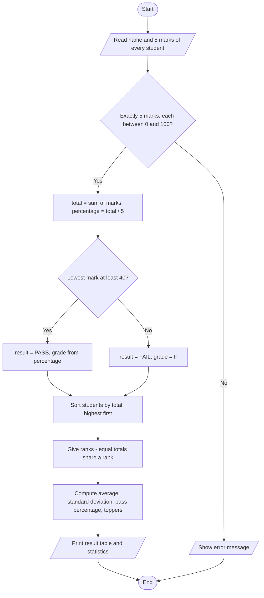

# Case Study 3: Student Result Analyzer

> **Files:** [`student_result_analyzer.py`](student_result_analyzer.py) · [`test_student_result_analyzer.py`](test_student_result_analyzer.py) · [`output.txt`](output.txt)

## 1. Problem Statement

A department needs a program that takes the marks of every student in five subjects and prepares a result sheet: total, percentage, grade, pass/fail status and rank. It must also report class statistics such as the average, standard deviation, pass percentage, the class topper(s) and the highest scorer in each subject.

## 2. Objectives

- Process lists and dictionaries of student data with loops and built-in functions (`sum`, `min`, `max`, `sorted`).
- Implement a grading scale using conditional statements.
- Rank students with ties handled correctly (1, 1, 3 style ranking).
- Compute basic statistics (mean, standard deviation, pass percentage) without external libraries.
- Validate input (number of marks and range 0-100).

## 3. Assumptions

- Five subjects (Maths, Physics, Chemistry, English, Python), each out of 100.
- A student passes only if every subject mark is at least 40; otherwise the result is FAIL and the grade is F.
- Grade scale on percentage: O >= 90, A+ >= 80, A >= 70, B >= 60, C >= 50, P >= 40, otherwise F.
- Rank is based on total marks among all students; equal totals share the same rank and the next rank is skipped.
- Standard deviation is the population standard deviation of the totals.

## 4. Algorithm

1. Start. Read the students' names and marks (or use the demo data).
2. For each student validate that there are exactly 5 marks and each is between 0 and 100.
3. total = sum of marks; percentage = total / 5 (rounded to 2 decimals).
4. If the lowest mark >= 40 then result = PASS and grade comes from the percentage; otherwise result = FAIL and grade = F.
5. Sort students by total (highest first, then by name).
6. Assign ranks: a student with the same total as the previous one gets the same rank, otherwise rank = position.
7. Compute class average, standard deviation = sqrt(mean of squared differences), pass percentage, topper list and the best mark in each subject.
8. Print the result table and statistics. Stop.

## 5. Pseudocode

```text
FUNCTION analyse(students)
    records <- empty list
    FOR EACH (name, marks) IN students
        validate marks (5 values, each 0..100)
        total <- SUM(marks)
        percentage <- ROUND(total / 5, 2)
        IF MIN(marks) >= 40 THEN result <- "PASS"; grade <- grade_of(percentage)
        ELSE result <- "FAIL"; grade <- "F"
        add record to records
    SORT records by total (descending), then name
    FOR i FROM 0 TO length(records) - 1
        IF i > 0 AND records[i].total = records[i-1].total THEN
            records[i].rank <- records[i-1].rank
        ELSE records[i].rank <- i + 1
    RETURN records
END FUNCTION
```

## 6. Flowchart

### 6.1 Result analysis



## 7. Source Code

The complete, commented program is in [`student_result_analyzer.py`](student_result_analyzer.py). It uses only the Python standard library (Python 3.8 or later).

```bash
python student_result_analyzer.py          # interactive menu / input
python student_result_analyzer.py --demo   # automatic sample run
```

## 8. Test Cases

Test file: `test_student_result_analyzer.py` (run `python test_student_result_analyzer.py` or add `--table` for this table).

| TC | Scenario / Input | Expected Output | Actual Output | Result |
|----|------------------|-----------------|---------------|--------|
| TC01 | Grade at 90% | `O` | `O` | PASS |
| TC02 | Grade at 89.99% | `A+` | `A+` | PASS |
| TC03 | Grade at 70% | `A` | `A` | PASS |
| TC04 | Grade at 40% (lowest pass) | `P` | `P` | PASS |
| TC05 | Grade at 39.99% | `F` | `F` | PASS |
| TC06 | All subjects 100 | `(500, 100.0, 'O', 'PASS')` | `(500, 100.0, 'O', 'PASS')` | PASS |
| TC07 | Marks 80,70,60,50,40 (lowest exactly 40) | `(300, 60.0, 'B', 'PASS')` | `(300, 60.0, 'B', 'PASS')` | PASS |
| TC08 | One subject 39 -> fails whole result | `(439, 87.8, 'F', 'FAIL')` | `(439, 87.8, 'F', 'FAIL')` | PASS |
| TC09 | Only 4 marks entered | `Error: Exactly 5 marks are required` | `Error: Exactly 5 marks are required` | PASS |
| TC10 | A mark of 101 | `Error: Marks must be between 0 and 100` | `Error: Marks must be between 0 and 100` | PASS |
| TC11 | A negative mark | `Error: Marks must be between 0 and 100` | `Error: Marks must be between 0 and 100` | PASS |
| TC12 | Ties share rank (90,90,80 totals) -> 1,1,3 | `[('A', 1), ('B', 1), ('C', 3)]` | `[('A', 1), ('B', 1), ('C', 3)]` | PASS |
| TC13 | Class average of totals 500, 250, 390 | `380.0` | `380.0` | PASS |
| TC14 | Pass percentage (2 of 3 pass) | `66.67` | `66.67` | PASS |
| TC15 | Topper of the class | `['A']` | `['A']` | PASS |
| TC16 | Highest mark in Maths (and who) | `(100, ['A'])` | `(100, ['A'])` | PASS |

**Result: 16/16 test cases passed**

## 9. Output

Command: `python student_result_analyzer.py --demo`

```text
Rank Name       Total       %  Grade  Result
1    Anil         458    91.6      O    PASS
1    Divya        458    91.6      O    PASS
3    Bhavya       400    80.0     A+    PASS
4    Esha         305    61.0      B    PASS
5    Charan       285    57.0      F    FAIL

Class average      : 381.2
Standard deviation : 73.77
Pass percentage    : 80.0 %
Topper(s)          : Anil, Divya
Highest in Maths     : 92 (Anil, Divya)
Highest in Physics   : 88 (Anil, Divya)
Highest in Chemistry : 95 (Anil, Divya)
Highest in English   : 85 (Anil, Divya)
Highest in Python    : 98 (Anil, Divya)
```

<!-- Add your own terminal screenshot here:
 -->

## 10. Conclusion

The analyzer turns raw marks into a complete report with correct grading, tie-aware ranking and class statistics. Keeping each calculation in its own function (grade, analyse, class_statistics) made it easy to test every rule separately; all 16 test cases pass, including the grade boundaries (89.99 vs 90) and the rule that one failed subject fails the whole result.
