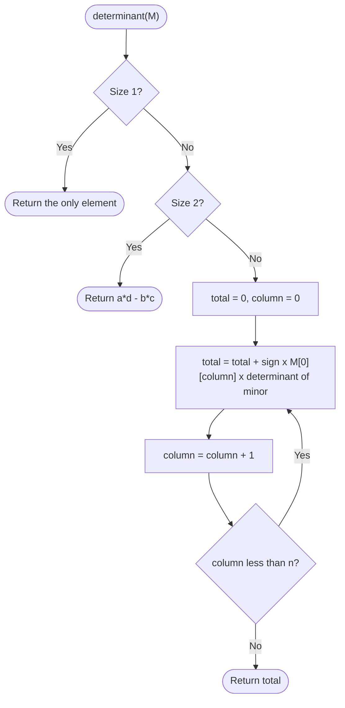
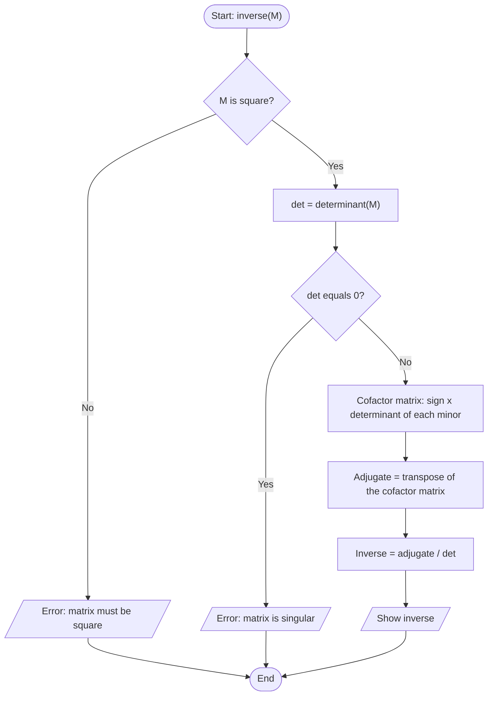

# Case Study 8: Matrix Operations Toolkit

> **Files:** [`matrix_toolkit.py`](matrix_toolkit.py) · [`test_matrix_toolkit.py`](test_matrix_toolkit.py) · [`output.txt`](output.txt)

## 1. Problem Statement

Develop a toolkit that performs common matrix operations without using external libraries: addition, subtraction, multiplication, transpose, trace, symmetry check, determinant of any square matrix and the inverse of an invertible matrix. The toolkit must reject invalid inputs (empty, ragged, wrongly sized, non-square or singular matrices) with clear messages.

## 2. Objectives

- Represent matrices as lists of lists and use nested loops and list comprehensions.
- Implement matrix multiplication with three nested loops.
- Implement the determinant recursively using cofactor expansion.
- Compute the inverse using cofactors, the adjugate and the determinant.
- Validate dimensions and raise meaningful `ValueError` messages.

## 3. Assumptions

- A matrix is a non-empty list of rows of equal length containing numbers.
- Determinant and inverse are defined only for square matrices; a matrix with determinant 0 is singular and has no inverse.
- Inverse values are rounded to 4 decimal places.
- Matrices are small; recursive cofactor expansion is efficient enough.

## 4. Algorithm

1. **Validate:** matrix is not empty and every row has the same length.
2. **Add / subtract:** sizes must be equal; combine corresponding elements.
3. **Multiply:** columns of A must equal rows of B; result[i][j] = sum over k of A[i][k] x B[k][j].
4. **Transpose:** element [i][j] of the result is element [j][i] of the original.
5. **Determinant:** size 1 -> the element; size 2 -> ad - bc; otherwise expand along the first row: sum of sign x element x determinant of its minor.
6. **Inverse:** matrix must be square and det != 0. Build the cofactor matrix, transpose it (adjugate) and divide every element by det.
7. **Trace / symmetry:** sum of the diagonal; a matrix is symmetric if it equals its transpose.
8. Show the result or the error message. Stop.

## 5. Pseudocode

```text
FUNCTION determinant(M)
    n <- size of M  (error if not square)
    IF n = 1 THEN RETURN M[0][0]
    IF n = 2 THEN RETURN M[0][0]*M[1][1] - M[0][1]*M[1][0]
    total <- 0
    FOR col FROM 0 TO n - 1
        sign <- +1 IF col is even ELSE -1
        total <- total + sign * M[0][col] * determinant(minor(M, 0, col))
    RETURN total
END FUNCTION

FUNCTION inverse(M)
    det <- determinant(M)
    IF det = 0 THEN error "Matrix is singular"
    FOR i, j: cofactor[i][j] <- (-1)^(i+j) * determinant(minor(M, i, j))
    adjugate <- transpose(cofactor)
    RETURN adjugate / det   (each element divided, rounded to 4 places)
END FUNCTION
```

## 6. Flowchart

### 6.1 Determinant (recursive)



### 6.2 Inverse



## 7. Source Code

The complete, commented program is in [`matrix_toolkit.py`](matrix_toolkit.py). It uses only the Python standard library (Python 3.8 or later).

```bash
python matrix_toolkit.py          # interactive menu / input
python matrix_toolkit.py --demo   # automatic sample run
```

## 8. Test Cases

Test file: `test_matrix_toolkit.py` (run `python test_matrix_toolkit.py` or add `--table` for this table).

| TC | Scenario / Input | Expected Output | Actual Output | Result |
|----|------------------|-----------------|---------------|--------|
| TC01 | A + B  (A=[[1,2],[3,4]], B=[[5,6],[7,8]]) | `[[6, 8], [10, 12]]` | `[[6, 8], [10, 12]]` | PASS |
| TC02 | A - B | `[[-4, -4], [-4, -4]]` | `[[-4, -4], [-4, -4]]` | PASS |
| TC03 | A x B | `[[19, 22], [43, 50]]` | `[[19, 22], [43, 50]]` | PASS |
| TC04 | Transpose of 2x3 [[1,2,3],[4,5,6]] | `[[1, 4], [2, 5], [3, 6]]` | `[[1, 4], [2, 5], [3, 6]]` | PASS |
| TC05 | Add 2x2 and 2x3 | `Error: Matrices must have the same size to add` | `Error: Matrices must have the same size to add` | PASS |
| TC06 | Multiply 2x2 by 3x2 (sizes do not match) | `Error: Columns of A must equal rows of B` | `Error: Columns of A must equal rows of B` | PASS |
| TC07 | Multiply 2x3 by 3x1 -> 2x1 | `[[14], [32]]` | `[[14], [32]]` | PASS |
| TC08 | Determinant of [[4,7],[2,6]] | `10` | `10` | PASS |
| TC09 | Determinant of 3x3 C | `1` | `1` | PASS |
| TC10 | Determinant of singular 3x3 | `0` | `0` | PASS |
| TC11 | Determinant of 4x4 matrix | `30` | `30` | PASS |
| TC12 | Determinant of a non-square matrix | `Error: Matrix must be square` | `Error: Matrix must be square` | PASS |
| TC13 | Inverse of [[4,7],[2,6]] | `[[0.6, -0.7], [-0.2, 0.4]]` | `[[0.6, -0.7], [-0.2, 0.4]]` | PASS |
| TC14 | Inverse of 3x3 C | `[[-24, 18, 5], [20, -15, -4], [-5, 4, 1]]` | `[[-24.0, 18.0, 5.0], [20.0, -15.0, -4.0], [-5.0, 4.0, 1.0]]` | PASS |
| TC15 | C x inverse(C) = identity | `[[1, 0, 0], [0, 1, 0], [0, 0, 1]]` | `[[1.0, 0.0, 0.0], [0.0, 1.0, 0.0], [0.0, 0.0, 1.0]]` | PASS |
| TC16 | Inverse of a singular matrix | `Error: Matrix is singular (determinant is 0)` | `Error: Matrix is singular (determinant is 0)` | PASS |
| TC17 | Inverse of 1x1 [[2]] | `[[0.5]]` | `[[0.5]]` | PASS |
| TC18 | Trace of A | `5` | `5` | PASS |
| TC19 | [[1,2],[2,1]] is symmetric | `True` | `True` | PASS |
| TC20 | A is symmetric | `False` | `False` | PASS |
| TC21 | Rows of different length | `Error: All rows must have the same length` | `Error: All rows must have the same length` | PASS |
| TC22 | Empty matrix | `Error: Matrix cannot be empty` | `Error: Matrix cannot be empty` | PASS |

**Result: 22/22 test cases passed**

## 9. Output

Command: `python matrix_toolkit.py --demo`

```text
A =
   [1, 2]
   [3, 4]
B =
   [5, 6]
   [7, 8]
A + B =
   [6, 8]
   [10, 12]
A - B =
   [-4, -4]
   [-4, -4]
A x B =
   [19, 22]
   [43, 50]
Transpose of A =
   [1, 3]
   [2, 4]
Trace of A = 5 | Symmetric? False

C =
   [1, 2, 3]
   [0, 1, 4]
   [5, 6, 0]
Determinant of C = 1
Inverse of C =
   [-24.0, 18.0, 5.0]
   [20.0, -15.0, -4.0]
   [-5.0, 4.0, 1.0]
C x inverse(C) =
   [1.0, 0.0, 0.0]
   [0.0, 1.0, 0.0]
   [0.0, 0.0, 1.0]

Inverse of [[1,2],[2,4]] -> Matrix is singular (determinant is 0)
```

<!-- Add your own terminal screenshot here:
 -->

## 10. Conclusion

The toolkit implements all the required matrix operations from first principles. The determinant uses recursion and the inverse is verified by checking that M x inverse(M) gives the identity matrix. All 22 test cases pass, including a 4x4 determinant, singular matrices and every validation error. The exercise builds a strong understanding of nested loops, recursion and defensive programming.
