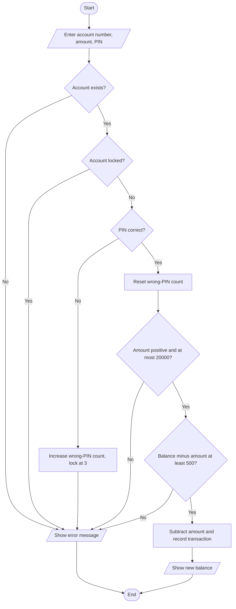

# Case Study 1: Banking System

> **Files:** [`banking_system.py`](banking_system.py) · [`test_banking_system.py`](test_banking_system.py) · [`output.txt`](output.txt)

## 1. Problem Statement

A small bank branch wants to replace its paper ledger with a computer program. The program must let customers open an account, deposit money, withdraw money, transfer money to another account and view a mini statement. Every withdrawal or transfer must be protected by a 4-digit PIN, the account must lock after three wrong PIN attempts, and the bank's rules (minimum balance and withdrawal limit) must always be enforced.

## 2. Objectives

- Model real-world entities (Account, Bank) using Python classes and objects.
- Store accounts in a dictionary and look them up by account number.
- Apply input validation and a custom exception class (`BankError`) for rule violations.
- Implement security logic: PIN verification, failed-attempt counter and account locking.
- Maintain a transaction history and print a mini statement.

## 3. Assumptions

- Single branch; data is kept in memory only (it is lost when the program ends).
- All amounts are in rupees; the minimum opening deposit and the minimum balance are Rs. 500.
- The maximum amount for one withdrawal or transfer is Rs. 20,000.
- The PIN is exactly 4 digits; deposits do not require a PIN.
- Account numbers are generated automatically starting from 1001. No interest is calculated.

## 4. Algorithm

1. Start. Create an empty bank (no accounts, next account number = 1001).
2. **Open account:** check name is not blank, PIN is 4 digits and deposit >= 500; create the account and return its number.
3. **Deposit:** find the account, check amount > 0, add the amount and record it.
4. **Withdraw:** find the account -> verify PIN (count wrong tries, lock at 3) -> check amount > 0 -> check amount <= 20000 -> check balance - amount >= 500 -> subtract and record.
5. **Transfer:** same checks as withdraw on the source account, plus: destination must exist and differ from the source; add the amount to the destination and record on both accounts.
6. **Statement:** print every recorded transaction with the balance after it.
7. Any rule violation raises `BankError`; the menu catches it and prints the message.
8. Repeat the menu until the user chooses Exit. Stop.

## 5. Pseudocode

```text
FUNCTION withdraw(acc_no, amount, pin)
    account <- find account acc_no            (error if not found)
    IF account is locked THEN error "Account is locked"
    IF pin != account.pin THEN
        account.failed_tries <- account.failed_tries + 1
        IF account.failed_tries >= 3 THEN
            lock account; error "Account locked after 3 wrong PINs"
        ELSE error "Wrong PIN"
    account.failed_tries <- 0
    IF amount <= 0 THEN error "Amount must be a positive number"
    IF amount > 20000 THEN error "Limit per withdrawal is 20000"
    IF account.balance - amount < 500 THEN error "Insufficient funds"
    account.balance <- account.balance - amount
    add ("WITHDRAW", amount, balance) to account.history
    RETURN account.balance
END FUNCTION
```

## 6. Flowchart

### 6.1 Withdraw money



## 7. Source Code

The complete, commented program is in [`banking_system.py`](banking_system.py). It uses only the Python standard library (Python 3.8 or later).

```bash
python banking_system.py          # interactive menu / input
python banking_system.py --demo   # automatic sample run
```

## 8. Test Cases

Test file: `test_banking_system.py` (run `python test_banking_system.py` or add `--table` for this table).

| TC | Scenario / Input | Expected Output | Actual Output | Result |
|----|------------------|-----------------|---------------|--------|
| TC01 | Open account: Asha, Rs.5000, PIN 1234 | `1001` | `1001` | PASS |
| TC02 | Open account with deposit Rs.400 (below minimum) | `Error: Opening deposit must be at least 500` | `Error: Opening deposit must be at least 500` | PASS |
| TC03 | Open account with PIN '12a4' | `Error: PIN must be exactly 4 digits` | `Error: PIN must be exactly 4 digits` | PASS |
| TC04 | Open account with blank name | `Error: Name cannot be empty` | `Error: Name cannot be empty` | PASS |
| TC05 | Deposit Rs.2000 into balance 5000 | `7000` | `7000` | PASS |
| TC06 | Deposit Rs.-50 | `Error: Amount must be a positive number` | `Error: Amount must be a positive number` | PASS |
| TC07 | Withdraw Rs.1500 with correct PIN | `3500` | `3500` | PASS |
| TC08 | Withdraw Rs.4600 (balance would fall to 400) | `Error: Insufficient funds (minimum balance rule)` | `Error: Insufficient funds (minimum balance rule)` | PASS |
| TC09 | Withdraw Rs.25000 (above per-withdrawal limit) | `Error: Limit per withdrawal is 20000` | `Error: Limit per withdrawal is 20000` | PASS |
| TC10 | Withdraw with wrong PIN | `Error: Wrong PIN` | `Error: Wrong PIN` | PASS |
| TC11 | Third wrong PIN in a row | `Error: Account locked after 3 wrong PINs` | `Error: Account locked after 3 wrong PINs` | PASS |
| TC12 | Correct PIN after account is locked | `Error: Account is locked` | `Error: Account is locked` | PASS |
| TC13 | Transfer Rs.1000 Asha -> Ravi (balances after) | `(4000, 2000)` | `(4000, 2000)` | PASS |
| TC14 | Transfer to the same account | `Error: Cannot transfer to the same account` | `Error: Cannot transfer to the same account` | PASS |
| TC15 | Transfer to a non-existent account | `Error: Account not found` | `Error: Account not found` | PASS |
| TC16 | Statement lines after open + deposit + withdraw | `3` | `3` | PASS |

**Result: 16/16 test cases passed**

## 9. Output

Command: `python banking_system.py --demo`

```text
Accounts opened: 1001 1002
Deposit 2000 to Asha -> balance 7000
Withdraw 1500 from Asha -> balance 5500
Transfer 3000 Asha->Ravi -> Asha balance 2500
Withdraw 5000 from Ravi (breaks minimum balance) -> Insufficient funds (minimum balance rule)
Withdraw with wrong PIN -> Wrong PIN
Wrong PIN again -> Wrong PIN
Wrong PIN third time -> Account locked after 3 wrong PINs
Correct PIN after lock -> Account is locked

Mini statement for Ravi:
  OPEN             1000.00   balance:    1000.00
  TRANSFER IN      3000.00   balance:    4000.00
```

<!-- Add your own terminal screenshot here:
 -->

## 10. Conclusion

The program implements a complete mini banking system using classes, dictionaries and exceptions. Every rule (PIN lock, minimum balance, limits) is checked before any balance changes, so an account can never be left in an invalid state. All 16 test cases pass, including the locked-account and minimum-balance edge cases. The design can be extended with file storage or interest calculation without changing the existing methods.
