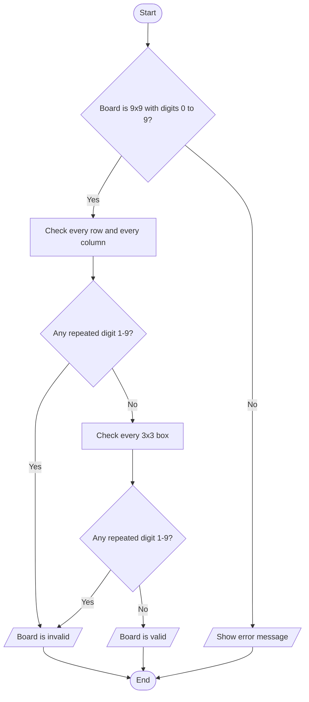
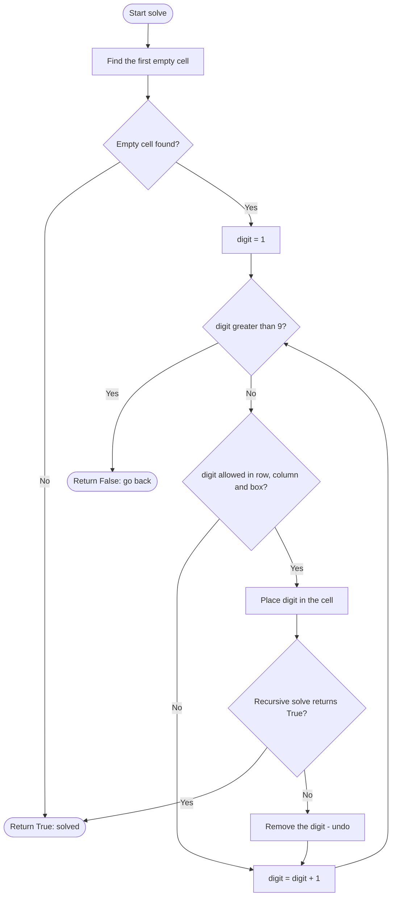

# Case Study 6: Sudoku Validator and Solver

> **Files:** [`sudoku.py`](sudoku.py) · [`test_sudoku.py`](test_sudoku.py) · [`output.txt`](output.txt)

## 1. Problem Statement

A Sudoku board is a 9x9 grid in which every row, every column and every 3x3 box must contain each digit 1-9 exactly once. Write a program that (a) checks whether a given board (with empty cells shown as 0) is valid, (b) checks whether it is completely and correctly filled, and (c) solves an unfinished puzzle automatically.

## 2. Objectives

- Work with two-dimensional lists (rows, columns and sub-grids).
- Detect duplicates using lists and sets.
- Understand and implement recursion and backtracking.
- Validate input shape and values and report errors clearly.

## 3. Assumptions

- The board is a list of 9 lists with 9 integers each; 0 represents an empty cell.
- A board is valid if no digit repeats in any row, column or 3x3 box (empty cells are ignored).
- The solver returns the first solution it finds; if none exists it returns False and leaves the board unchanged.
- A built-in sample puzzle is used for the demo.

## 4. Algorithm

1. **Validator:** check the board is 9x9 and every cell is an integer from 0 to 9.
2. For each index i from 0 to 8 take row i and column i; if either has a repeated non-zero digit -> invalid.
3. For each of the nine 3x3 boxes collect its 9 cells; a repeated non-zero digit -> invalid. Otherwise valid.
4. **Complete check:** the board is valid and has no 0 cell.
5. **Solver (backtracking):** find the first empty cell. If there is none the puzzle is solved.
6. Try digits 1 to 9 in that cell; a digit is allowed if it is not already in the cell's row, column or box.
7. Place an allowed digit and solve the rest recursively. If that fails, remove the digit (undo) and try the next one.
8. If no digit fits, return False so the previous cell can try a different digit. Stop.

## 5. Pseudocode

```text
FUNCTION solve(board)
    FOR row FROM 0 TO 8
        FOR col FROM 0 TO 8
            IF board[row][col] = 0 THEN
                FOR digit FROM 1 TO 9
                    IF can_place(board, row, col, digit) THEN
                        board[row][col] <- digit
                        IF solve(board) THEN RETURN True
                        board[row][col] <- 0          // undo (backtrack)
                RETURN False                          // no digit fits here
    RETURN True                                       // no empty cell left
END FUNCTION

FUNCTION is_valid(board)
    FOR i FROM 0 TO 8
        IF has_duplicates(row i) OR has_duplicates(column i) THEN RETURN False
    FOR EACH 3x3 box
        IF has_duplicates(box) THEN RETURN False
    RETURN True
END FUNCTION
```

## 6. Flowchart

### 6.1 Validity check



### 6.2 Backtracking solver



## 7. Source Code

The complete, commented program is in [`sudoku.py`](sudoku.py). It uses only the Python standard library (Python 3.8 or later).

```bash
python sudoku.py          # interactive menu / input
python sudoku.py --demo   # automatic sample run
```

## 8. Test Cases

Test file: `test_sudoku.py` (run `python test_sudoku.py` or add `--table` for this table).

| TC | Scenario / Input | Expected Output | Actual Output | Result |
|----|------------------|-----------------|---------------|--------|
| TC01 | Sample puzzle (partly filled) is valid | `True` | `True` | PASS |
| TC02 | Duplicate 7 in a row only (put 7 at row 1, col 9) | `False` | `False` | PASS |
| TC03 | Duplicate 3 in a column only (put 3 at row 9, col 2) | `False` | `False` | PASS |
| TC04 | Duplicate 9 in a 3x3 box only (put 9 at row 1, col 3) | `False` | `False` | PASS |
| TC05 | Legal extra digit (put 4 at row 1, col 3) | `True` | `True` | PASS |
| TC06 | Board with only 8 rows | `Error: Board must be 9x9` | `Error: Board must be 9x9` | PASS |
| TC07 | Cell containing 10 | `Error: Cells must be integers from 0 to 9` | `Error: Cells must be integers from 0 to 9` | PASS |
| TC08 | Unsolved puzzle is not complete | `False` | `False` | PASS |
| TC09 | Solver returns True for the sample puzzle | `True` | `True` | PASS |
| TC10 | Solved grid equals the known solution | `['534678912', '672195348', '198342567', '859761423', '426853791', '713924856', '961537284', '287419635', '345286179']` | `['534678912', '672195348', '198342567', '859761423', '426853791', '713924856', '961537284', '287419635', '345286179']` | PASS |
| TC11 | Solved grid is valid and complete | `True` | `True` | PASS |
| TC12 | Unsolvable board: (valid?, solved?, board unchanged?) | `(True, False, True)` | `(True, False, True)` | PASS |
| TC13 | Empty board: (solved?, complete?) | `(True, True)` | `(True, True)` | PASS |

**Result: 13/13 test cases passed**

## 9. Output

Command: `python sudoku.py --demo`

```text
Puzzle:
5 3 . | . 7 . | . . .
6 . . | 1 9 5 | . . .
. 9 8 | . . . | . 6 .
------+-------+------
8 . . | . 6 . | . . 3
4 . . | 8 . 3 | . . 1
7 . . | . 2 . | . . 6
------+-------+------
. 6 . | . . . | 2 8 .
. . . | 4 1 9 | . . 5
. . . | . 8 . | . 7 9

Puzzle valid? True

Solution:
5 3 4 | 6 7 8 | 9 1 2
6 7 2 | 1 9 5 | 3 4 8
1 9 8 | 3 4 2 | 5 6 7
------+-------+------
8 5 9 | 7 6 1 | 4 2 3
4 2 6 | 8 5 3 | 7 9 1
7 1 3 | 9 2 4 | 8 5 6
------+-------+------
9 6 1 | 5 3 7 | 2 8 4
2 8 7 | 4 1 9 | 6 3 5
3 4 5 | 2 8 6 | 1 7 9

Solution valid and complete? True
```

<!-- Add your own terminal screenshot here:
 -->

## 10. Conclusion

The program validates and solves Sudoku puzzles using nested lists and recursive backtracking. The solver finds the unique solution of the sample puzzle, correctly reports an unsolvable board without damaging it, and the validator pinpoints row-only, column-only and box-only mistakes (13 of 13 test cases pass). Backtracking is a general technique that also applies to problems such as N-Queens and maze solving.
