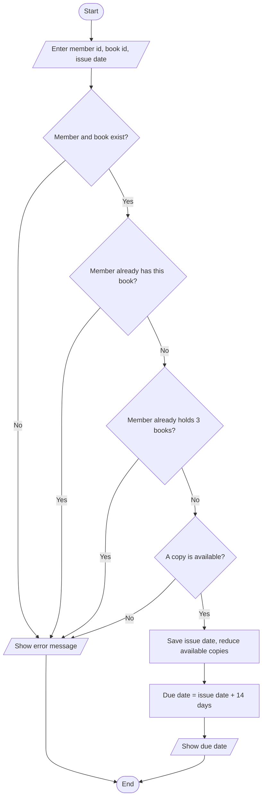
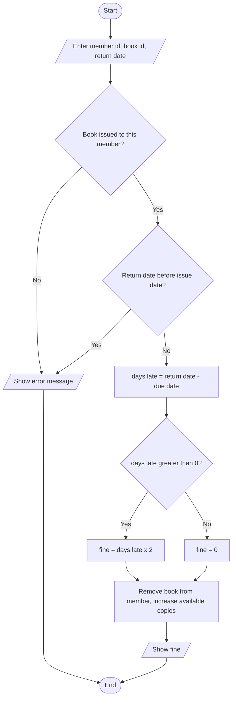

# Case Study 2: Library Management System

> **Files:** [`library_management.py`](library_management.py) · [`test_library_management.py`](test_library_management.py) · [`output.txt`](output.txt)

## 1. Problem Statement

A college library needs a program to manage its books and members. Members may borrow at most 3 books for 14 days. A fine of Rs. 2 per day is charged for late returns. The librarian must be able to add books, register members, issue and return books, search the catalogue by title or author, and see an overdue report.

## 2. Objectives

- Use nested dictionaries to store books and members together with their relationships.
- Work with the `datetime` module (`date`, `timedelta`) to compute due dates and late days.
- Enforce business rules: borrowing limit, copy availability, duplicate issue, fine calculation.
- Implement case-insensitive searching and a report generated from stored data.

## 3. Assumptions

- Each book has a unique id and one or more identical copies.
- Loan period is 14 days; the fine is Rs. 2 for every day after the due date; no maximum fine.
- A member may hold at most 3 books and cannot hold two copies of the same book.
- Dates are supplied by the caller (the interactive menu uses today's date).
- Data is stored in memory only.

## 4. Algorithm

1. Start. Create empty dictionaries for books and members.
2. **Add book:** if the id exists, increase its copies and available count; otherwise create a new entry.
3. **Register member:** reject duplicate ids and blank names.
4. **Issue:** check member and book exist -> member does not already hold the book -> member holds fewer than 3 books -> a copy is available. Save the issue date, reduce `available`, return due date = issue date + 14 days.
5. **Return:** check the book is with the member and return date is not before issue date. days_late = max(0, return date - due date). Fine = days_late x 2. Increase `available`.
6. **Search:** return sorted ids of books whose title or author contains the keyword (ignoring case).
7. **Overdue report:** for every issued book with today > due date, list member, title, days late and fine.
8. Repeat the menu until Exit. Stop.

## 5. Pseudocode

```text
FUNCTION issue_book(member_id, book_id, issue_date)
    IF member_id not in members THEN error "Member not found"
    IF book_id not in books THEN error "Book not found"
    IF book_id in member.issued THEN error "Member already has this book"
    IF length(member.issued) >= 3 THEN error "Borrowing limit reached"
    IF book.available = 0 THEN error "No copy available"
    member.issued[book_id] <- issue_date
    book.available <- book.available - 1
    RETURN issue_date + 14 days
END FUNCTION

FUNCTION return_book(member_id, book_id, return_date)
    check member exists and book_id in member.issued
    IF return_date < issue_date THEN error
    days_late <- MAX(0, (return_date - (issue_date + 14 days)).days)
    remove book_id from member.issued; book.available <- book.available + 1
    RETURN days_late * 2
END FUNCTION
```

## 6. Flowchart

### 6.1 Issue a book



### 6.2 Return a book and calculate the fine



## 7. Source Code

The complete, commented program is in [`library_management.py`](library_management.py). It uses only the Python standard library (Python 3.8 or later).

```bash
python library_management.py          # interactive menu / input
python library_management.py --demo   # automatic sample run
```

## 8. Test Cases

Test file: `test_library_management.py` (run `python test_library_management.py` or add `--table` for this table).

| TC | Scenario / Input | Expected Output | Actual Output | Result |
|----|------------------|-----------------|---------------|--------|
| TC01 | Issue B1 to M1 on 2026-10-01 (due date) | `2026-10-15` | `2026-10-15` | PASS |
| TC02 | Issue a 4th book to M1 (limit is 3) | `Error: Borrowing limit reached` | `Error: Borrowing limit reached` | PASS |
| TC03 | M2 borrows B2 after M1 took the only copy | `Error: No copy available` | `Error: No copy available` | PASS |
| TC04 | M1 borrows the same book twice | `Error: Member already has this book` | `Error: Member already has this book` | PASS |
| TC05 | Issue to unknown member | `Error: Member not found` | `Error: Member not found` | PASS |
| TC06 | Issue unknown book | `Error: Book not found` | `Error: Book not found` | PASS |
| TC07 | Return on due date (15 Oct) - fine | `0` | `0` | PASS |
| TC08 | Return 5 days late (20 Oct) - fine | `10` | `10` | PASS |
| TC09 | Return before issue date | `Error: Return date is before issue date` | `Error: Return date is before issue date` | PASS |
| TC10 | Return a book never issued | `Error: This book was not issued to the member` | `Error: This book was not issued to the member` | PASS |
| TC11 | Available copies of B2 after issue + return | `1` | `1` | PASS |
| TC12 | Search 'PYTHON' (case-insensitive) | `['B1', 'B2', 'B4']` | `['B1', 'B2', 'B4']` | PASS |
| TC13 | Search author 'lutz' | `['B2']` | `['B2']` | PASS |
| TC14 | Search 'xyz' (no match) | `[]` | `[]` | PASS |
| TC15 | Overdue report on 25 Oct for B1 issued 1 Oct | `[('Meena', 'Python Crash Course', 10, 20)]` | `[('Meena', 'Python Crash Course', 10, 20)]` | PASS |
| TC16 | Add 3 more copies of existing B1 (copies, available) | `(5, 5)` | `(5, 5)` | PASS |
| TC17 | Register the same member id twice | `Error: Member already registered` | `Error: Member already registered` | PASS |

**Result: 17/17 test cases passed**

## 9. Output

Command: `python library_management.py --demo`

```text
Search 'python': ['B1', 'B2', 'B4']
Due date for B1 (M1): 2026-10-15
M1 borrows 4th book -> Borrowing limit reached
M2 borrows B2 (no copy left) -> No copy available
Overdue report on 25 Oct: [('Meena', 'Python Crash Course', 10, 20), ('Meena', 'Learning Python', 10, 20), ('Meena', 'Automate the Boring Stuff', 10, 20)]
Fine returning B1 on 10 Oct : 0
Fine returning B2 on 20 Oct : 10
```

<!-- Add your own terminal screenshot here:
 -->

## 10. Conclusion

The system correctly manages the full borrow-and-return cycle, including limits, availability and fines calculated from real calendar dates. Using dictionaries for books and members made lookups simple and fast. All 17 test cases pass, covering boundary days (return exactly on the due date gives no fine) and every error path. A database or file could replace the dictionaries later without changing the rules.
