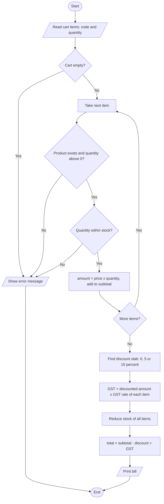

# Case Study 4: Inventory and Billing System

> **Files:** [`inventory_billing.py`](inventory_billing.py) · [`test_inventory_billing.py`](test_inventory_billing.py) · [`output.txt`](output.txt)

## 1. Problem Statement

A retail shop wants software to keep track of its products and generate customer bills. Each product has a price, a stock quantity and a GST rate. A bill must check stock, apply a volume discount (5% for subtotal of Rs. 2000 or more, 10% for Rs. 5000 or more), calculate GST on the discounted amount, update the stock and warn about items that are running low.

## 2. Objectives

- Maintain an inventory in a dictionary of dictionaries.
- Implement a billing algorithm with discount slabs and per-item tax calculation.
- Make the operation safe: stock is reduced only when the whole bill is valid (all-or-nothing).
- Format a neat, aligned bill using f-strings.
- Generate a low-stock report for restocking decisions.

## 3. Assumptions

- Prices are in rupees; GST rate is between 0 and 28 percent and is different for each product.
- The discount is decided by the subtotal before tax and is applied to every item equally.
- GST is calculated on the price after discount.
- Low-stock limit is fewer than 5 units.
- Data is held in memory; a single cashier uses the program.

## 4. Algorithm

1. Start. Create an empty product dictionary and add products with code, name, price, stock and GST%.
2. Read the cart as a list of (code, quantity); stop with an error if it is empty.
3. For every item check that the product exists, quantity > 0 and quantity <= stock. Add price x quantity to the subtotal.
4. Choose the discount: 10% if subtotal >= 5000, 5% if subtotal >= 2000, otherwise 0.
5. For every item: GST = (amount x (1 - discount rate)) x GST% / 100; add to the GST total.
6. Only now reduce the stock of every purchased item.
7. total = subtotal - discount + GST. Print the formatted bill.
8. Low-stock report: list products whose stock is below 5. Stop.

## 5. Pseudocode

```text
FUNCTION make_bill(items)
    IF items is empty THEN error "Cart is empty"
    subtotal <- 0
    FOR EACH (code, qty) IN items
        IF code not in products THEN error "Product not found"
        IF qty <= 0 THEN error "Quantity must be positive"
        IF qty > products[code].stock THEN error "Insufficient stock"
        amount <- price * qty;  subtotal <- subtotal + amount
    rate <- 0.10 IF subtotal >= 5000, 0.05 IF subtotal >= 2000, ELSE 0
    discount <- subtotal * rate
    gst <- SUM over items of (amount * (1 - rate) * gst_percent / 100)
    FOR EACH (code, qty) IN items: products[code].stock <- products[code].stock - qty
    RETURN subtotal, discount, gst, total = subtotal - discount + gst
END FUNCTION
```

## 6. Flowchart

### 6.1 Generate a bill



## 7. Source Code

The complete, commented program is in [`inventory_billing.py`](inventory_billing.py). It uses only the Python standard library (Python 3.8 or later).

```bash
python inventory_billing.py          # interactive menu / input
python inventory_billing.py --demo   # automatic sample run
```

## 8. Test Cases

Test file: `test_inventory_billing.py` (run `python test_inventory_billing.py` or add `--table` for this table).

| TC | Scenario / Input | Expected Output | Actual Output | Result |
|----|------------------|-----------------|---------------|--------|
| TC01 | Bill: 10 x Notebook (no discount) | `(600.0, 0.0, 72.0, 672.0)` | `(600.0, 0.0, 72.0, 672.0)` | PASS |
| TC02 | Bill: 3 x Calculator (5% discount slab) | `(2550.0, 127.5, 436.05, 2858.55)` | `(2550.0, 127.5, 436.05, 2858.55)` | PASS |
| TC03 | Bill: 4 x Backpack (10% discount slab) | `(6000.0, 600.0, 972.0, 6372.0)` | `(6000.0, 600.0, 972.0, 6372.0)` | PASS |
| TC04 | Discount rate for Rs.1999.99 | `0.0` | `0.0` | PASS |
| TC05 | Discount rate for Rs.2000 | `0.05` | `0.05` | PASS |
| TC06 | Discount rate for Rs.4999.99 | `0.05` | `0.05` | PASS |
| TC07 | Discount rate for Rs.5000 | `0.1` | `0.1` | PASS |
| TC08 | Notebook stock after selling 10 | `90` | `90` | PASS |
| TC09 | Ask for more than the stock (7 Backpacks) | `Error: Insufficient stock for Backpack` | `Error: Insufficient stock for Backpack` | PASS |
| TC10 | Failed bill must not reduce stock of valid items | `100` | `100` | PASS |
| TC11 | Unknown product code P9 | `Error: Product not found: P9` | `Error: Product not found: P9` | PASS |
| TC12 | Quantity 0 | `Error: Quantity must be positive` | `Error: Quantity must be positive` | PASS |
| TC13 | Empty cart | `Error: Cart is empty` | `Error: Cart is empty` | PASS |
| TC14 | Low-stock list after selling 3 Backpacks | `['Backpack']` | `['Backpack']` | PASS |
| TC15 | Restock with negative quantity | `Error: Quantity must be positive` | `Error: Quantity must be positive` | PASS |
| TC16 | Add product with GST 40% | `Error: Invalid price, stock or GST rate` | `Error: Invalid price, stock or GST rate` | PASS |

**Result: 16/16 test cases passed**

## 9. Output

Command: `python inventory_billing.py --demo`

```text
BILL 1
Item           Qty    Price     Amount
Notebook        10    60.00     600.00
Pen Pack         2   120.00     240.00
--------------------------------------
Subtotal                        840.00
Discount                         -0.00
GST                             100.80
TOTAL                           940.80

BILL 2 (qualifies for 10% discount)
Item           Qty    Price     Amount
Calculator       3   850.00    2550.00
Backpack         4  1500.00    6000.00
--------------------------------------
Subtotal                       8550.00
Discount                       -855.00
GST                            1385.10
TOTAL                          9080.10

Low stock items: ['Backpack']
Bill 3 error: Insufficient stock for Backpack
```

<!-- Add your own terminal screenshot here:
 -->

## 10. Conclusion

The billing system produces correct bills with slab discounts and item-wise GST, and it protects the inventory by validating the entire cart before changing any stock. The 16 test cases confirm the discount boundaries (1999.99, 2000, 4999.99, 5000), the all-or-nothing stock update and the low-stock report. The program can be extended with product categories, invoice numbers or printing to a file.
