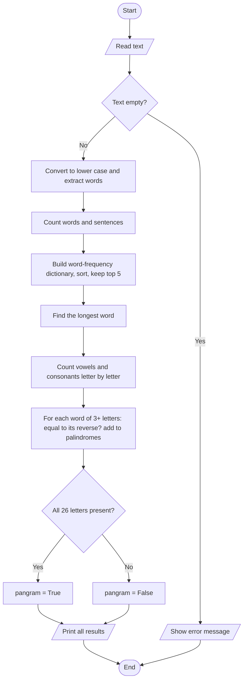

# Case Study 5: Text Analyzer

> **Files:** [`text_analyzer.py`](text_analyzer.py) · [`test_text_analyzer.py`](test_text_analyzer.py) · [`output.txt`](output.txt)

## 1. Problem Statement

Write a program that analyses a paragraph typed by the user and reports: the number of words and sentences, the five most frequent words, the longest word, the number of vowels and consonants, all palindrome words, whether the text is a pangram (uses every letter of the alphabet) and the average word length.

## 2. Objectives

- Practice string methods (`lower`, `split`, slicing `[::-1]`) and regular expressions (`re`).
- Use dictionaries to count word frequencies and `sorted` with a custom key.
- Use sets to remove duplicates and to test the pangram condition.
- Break a large task into small reusable functions that each do one job.

## 3. Assumptions

- A word consists of English letters and apostrophes; digits and punctuation are ignored.
- Text is compared in lower case, so `The` and `the` are the same word.
- A sentence ends with `.`, `!` or `?`; text without these still counts as one sentence if it is not empty.
- A palindrome word must have at least 3 letters (single letters are ignored).
- Ties in word frequency are listed alphabetically.

## 4. Algorithm

1. Start. Read the text; if it is empty or only spaces, show an error and stop.
2. Convert to lower case and extract the words with a regular expression.
3. Count words; count sentences by splitting at `.`, `!`, `?` and ignoring empty pieces.
4. Build a dictionary word -> count; sort by count (descending) then word (ascending); keep the first 5.
5. Find the longest word by comparing lengths one by one.
6. Loop over every character: count vowels (a, e, i, o, u) and other letters as consonants.
7. For every word of length >= 3, if word == reversed word, add it to a set of palindromes.
8. Collect the distinct letters; if there are 26, the text is a pangram.
9. average word length = total letters in words / number of words. Print all results. Stop.

## 5. Pseudocode

```text
FUNCTION analyse(text)
    IF text is empty THEN error "Text is empty"
    words <- all lowercase words in text
    counts <- empty dictionary
    FOR EACH w IN words: counts[w] <- counts.get(w, 0) + 1
    top_words <- first 5 of counts sorted by (count DESC, word ASC)
    longest <- ""
    FOR EACH w IN words: IF length(w) > length(longest) THEN longest <- w
    vowels <- 0; consonants <- 0
    FOR EACH ch IN lowercase(text)
        IF ch in "aeiou" THEN vowels <- vowels + 1
        ELSE IF ch is a letter THEN consonants <- consonants + 1
    palindromes <- set of w IN words WHERE length(w) >= 3 AND w = reverse(w)
    pangram <- (number of distinct letters in text = 26)
    RETURN all results
END FUNCTION
```

## 6. Flowchart

### 6.1 Text analysis



## 7. Source Code

The complete, commented program is in [`text_analyzer.py`](text_analyzer.py). It uses only the Python standard library (Python 3.8 or later).

```bash
python text_analyzer.py          # interactive menu / input
python text_analyzer.py --demo   # automatic sample run
```

## 8. Test Cases

Test file: `test_text_analyzer.py` (run `python test_text_analyzer.py` or add `--table` for this table).

| TC | Scenario / Input | Expected Output | Actual Output | Result |
|----|------------------|-----------------|---------------|--------|
| TC01 | Words of "Hello, World! It's 5 PM" | `['hello', 'world', "it's", 'pm']` | `['hello', 'world', "it's", 'pm']` | PASS |
| TC02 | Sentences in "Hi. How are you? Fine!" | `3` | `3` | PASS |
| TC03 | Sentences in "No end" (no punctuation) | `1` | `1` | PASS |
| TC04 | Sentences in "..." | `0` | `0` | PASS |
| TC05 | Top 2 words of "a b a c b a" | `[('a', 3), ('b', 2)]` | `[('a', 3), ('b', 2)]` | PASS |
| TC06 | Equal counts sorted alphabetically | `[('apple', 2), ('pear', 2)]` | `[('apple', 2), ('pear', 2)]` | PASS |
| TC07 | Longest word of "I love programming" | `programming` | `programming` | PASS |
| TC08 | Longest word of empty text | `` | `` | PASS |
| TC09 | Vowels/consonants of "Hello World 123" | `(3, 7)` | `(3, 7)` | PASS |
| TC10 | Palindromes in "Madam Anna saw a level civic noon" | `['anna', 'civic', 'level', 'madam', 'noon']` | `['anna', 'civic', 'level', 'madam', 'noon']` | PASS |
| TC11 | Single-letter words are not palindromes | `[]` | `[]` | PASS |
| TC12 | Pangram: quick brown fox sentence | `True` | `True` | PASS |
| TC13 | Pangram: "Hello world" | `False` | `False` | PASS |
| TC14 | Average word length of "ab abcd" | `3.0` | `3.0` | PASS |
| TC15 | Full analysis of "One two three." (words, sentences, longest) | `(3, 1, 'three')` | `(3, 1, 'three')` | PASS |
| TC16 | Empty text | `Error: Text is empty` | `Error: Text is empty` | PASS |
| TC17 | Only spaces | `Error: Text is empty` | `Error: Text is empty` | PASS |

**Result: 17/17 test cases passed**

## 9. Output

Command: `python text_analyzer.py --demo`

```text
Text: The quick brown fox jumps over the lazy dog. Madam saw a level road near the civic centre! Is the dog lazy or is the fox quick? 

words           : 27
sentences       : 3
top_words       : [('the', 5), ('dog', 2), ('fox', 2), ('is', 2), ('lazy', 2)]
longest_word    : centre
vowels          : 36
consonants      : 62
palindromes     : ['civic', 'level', 'madam']
pangram         : True
avg_word_length : 3.63
```

<!-- Add your own terminal screenshot here:
 -->

## 10. Conclusion

The analyzer produces nine different statistics from a single text using only strings, dictionaries, sets and a small regular expression. Each statistic is a separate function, which made testing easy: all 17 test cases pass, including empty input, ties in word frequency and single-letter words. The same functions can be reused in other text-processing programs such as plagiarism or readability checkers.
