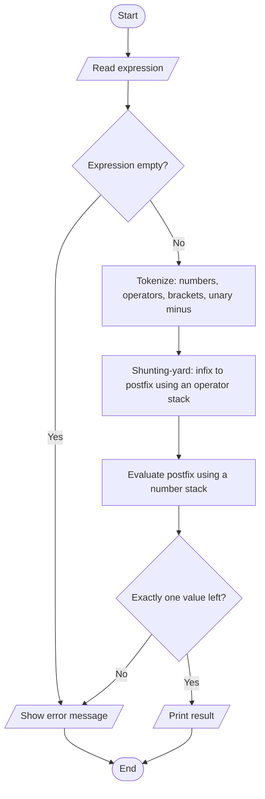
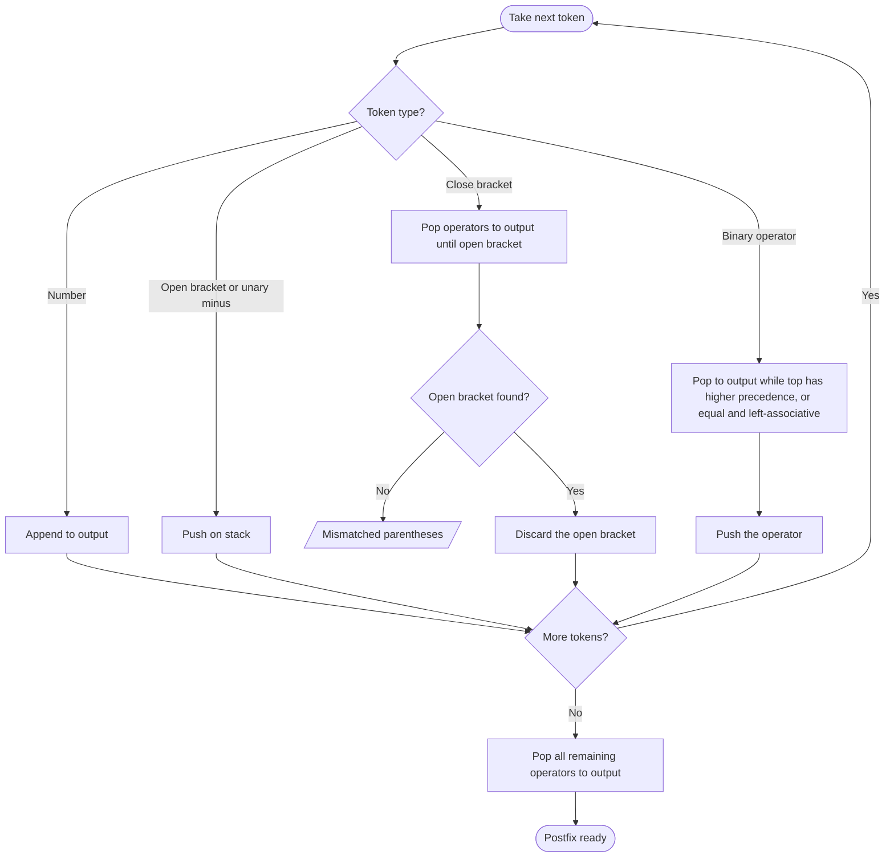

# Case Study 9: Infix Expression Evaluator using Stacks

> **Files:** [`expression_evaluator.py`](expression_evaluator.py) · [`test_expression_evaluator.py`](test_expression_evaluator.py) · [`output.txt`](output.txt)

## 1. Problem Statement

Write a program that evaluates arithmetic expressions typed by the user, such as `3 + 4 * (2 - 1) ^ 2`, without using Python's `eval()`. It must follow the correct operator precedence and associativity, support brackets, decimal numbers, unary minus and the power operator, and report errors such as mismatched brackets, division by zero and invalid input.

## 2. Objectives

- Understand the stack data structure (LIFO) and implement it with Python lists.
- Implement the Shunting-yard algorithm to convert infix expressions to postfix.
- Evaluate a postfix expression with a stack.
- Handle operator precedence, left/right associativity and unary operators.
- Practise robust error handling for malformed input.

## 3. Assumptions

- Supported operators: `+  -  *  /  ^` (power) and brackets `( )`.
- Precedence from low to high: `+ -`, then `* /`, then unary minus, then `^`. Power is right-associative (2^3^2 = 512).
- Unary minus is allowed at the start, after `(`, or after another operator; `-2^2` equals -4.
- Numbers may have a decimal point; results that are whole numbers are shown without `.0`.
- Variables and functions (sin, log, ...) are not supported.

## 4. Algorithm

1. **Tokenize:** scan the text; read whole numbers (including decimals); treat `+ - * / ^ ( )` as tokens; a `-` at the start or after an operator or `(` becomes a unary-minus token; reject any other character.
2. **Convert to postfix (Shunting-yard):** keep an output list and an operator stack.
3. Number -> output. `(` -> push. `)` -> pop operators to the output until `(` is found (error if none).
4. Unary minus -> push. Binary operator -> while the stack top has higher precedence (or equal precedence and the operator is left-associative) pop it to the output; then push the operator.
5. At the end pop all remaining operators to the output (error if a `(` remains).
6. **Evaluate postfix:** scan the output; push numbers; for an operator pop the needed operands, compute, push the result (error on division by zero, missing operands or a non-real result).
7. At the end exactly one value must remain on the stack - that is the answer; otherwise the expression is invalid. Stop.

## 5. Pseudocode

```text
FUNCTION to_postfix(tokens)
    output <- empty list;  stack <- empty stack
    FOR EACH token IN tokens
        IF token is a number THEN APPEND token TO output
        ELSE IF token = "(" THEN PUSH token
        ELSE IF token = ")" THEN
            WHILE stack not empty AND top != "(": APPEND POP() TO output
            IF stack is empty THEN error "Mismatched parentheses"
            POP "("
        ELSE IF token = unary minus THEN PUSH token
        ELSE                                       // binary operator
            WHILE stack not empty AND top != "(" AND
                  (prec(top) > prec(token) OR (prec(top) = prec(token) AND token is left-associative))
                APPEND POP() TO output
            PUSH token
    WHILE stack not empty
        IF top = "(" THEN error "Mismatched parentheses"
        APPEND POP() TO output
    RETURN output
END FUNCTION
```

## 6. Flowchart

### 6.1 Overall process



### 6.2 Shunting-yard conversion



## 7. Source Code

The complete, commented program is in [`expression_evaluator.py`](expression_evaluator.py). It uses only the Python standard library (Python 3.8 or later).

```bash
python expression_evaluator.py          # interactive menu / input
python expression_evaluator.py --demo   # automatic sample run
```

## 8. Test Cases

Test file: `test_expression_evaluator.py` (run `python test_expression_evaluator.py` or add `--table` for this table).

| TC | Scenario / Input | Expected Output | Actual Output | Result |
|----|------------------|-----------------|---------------|--------|
| TC01 | 2 + 3 * 4  (multiplication first) | `14` | `14` | PASS |
| TC02 | (2 + 3) * 4  (brackets first) | `20` | `20` | PASS |
| TC03 | 10 / 4  (decimal result) | `2.5` | `2.5` | PASS |
| TC04 | 100 - 10 - 5  (left to right) | `85` | `85` | PASS |
| TC05 | 100 / 10 / 5  (left to right) | `2` | `2` | PASS |
| TC06 | 2 ^ 3 ^ 2  (power is right-to-left) | `512` | `512` | PASS |
| TC07 | -2 ^ 2  (unary minus after power) | `-4` | `-4` | PASS |
| TC08 | 2 * -3  (unary minus after operator) | `-6` | `-6` | PASS |
| TC09 | 5 - -3 | `8` | `8` | PASS |
| TC10 | -(2 + 3) | `-5` | `-5` | PASS |
| TC11 | +5 + 3  (unary plus) | `8` | `8` | PASS |
| TC12 | 1.5 + 2.5  (decimals) | `4` | `4` | PASS |
| TC13 | 2 ^ -2 | `0.25` | `0.25` | PASS |
| TC14 | ((1+2)*(3+4))/7  (nested brackets, no spaces) | `3` | `3` | PASS |
| TC15 | 3 + 4 * 2 / ( 1 - 5 ) ^ 2 ^ 3  (classic example) | `3.000122` | `3.000122` | PASS |
| TC16 | Postfix of 2 + 3 * 4 | `2 3 4 * +` | `2 3 4 * +` | PASS |
| TC17 | Postfix of (2 + 3) * 4 | `2 3 + 4 *` | `2 3 + 4 *` | PASS |
| TC18 | Missing closing bracket: (2 + 3 | `Error: Mismatched parentheses` | `Error: Mismatched parentheses` | PASS |
| TC19 | Extra closing bracket: 2 + 3) | `Error: Mismatched parentheses` | `Error: Mismatched parentheses` | PASS |
| TC20 | Division by zero: 5 / 0 | `Error: Division by zero` | `Error: Division by zero` | PASS |
| TC21 | Operator without operand: 2 + | `Error: Invalid expression` | `Error: Invalid expression` | PASS |
| TC22 | Two numbers, no operator: 2 3 | `Error: Invalid expression` | `Error: Invalid expression` | PASS |
| TC23 | Empty brackets: () | `Error: Invalid expression` | `Error: Invalid expression` | PASS |
| TC24 | Invalid character: 7 & 2 | `Error: Invalid character: &` | `Error: Invalid character: &` | PASS |
| TC25 | Bad number: 1.2.3 + 1 | `Error: Invalid number: 1.2.3` | `Error: Invalid number: 1.2.3` | PASS |
| TC26 | Square root of negative: (-8) ^ 0.5 | `Error: Result is not a real number` | `Error: Result is not a real number` | PASS |
| TC27 | Empty expression | `Error: Expression is empty` | `Error: Expression is empty` | PASS |

**Result: 27/27 test cases passed**

## 9. Output

Command: `python expression_evaluator.py --demo`

```text
2 + 3 * 4                        = 14
(2 + 3) * 4                      = 20
10 / 4                           = 2.5
2 ^ 3 ^ 2                        = 512
-2 ^ 2                           = -4
2 * -3                           = -6
3 + 4 * 2 / ( 1 - 5 ) ^ 2 ^ 3    = 3.000122
(2 + 3                           -> Error: Mismatched parentheses
5 / 0                            -> Error: Division by zero
2 +                              -> Error: Invalid expression
7 & 2                            -> Error: Invalid character: &
```

<!-- Add your own terminal screenshot here:
 -->

## 10. Conclusion

The evaluator correctly handles precedence, associativity, brackets, unary minus and decimal numbers using two stacks and the Shunting-yard algorithm, with no use of `eval()`. The 27 test cases (including `2^3^2 = 512`, `-2^2 = -4` and the classic textbook example) pass, and every malformed input is reported with a clear message. The same idea is used inside compilers, calculators and spreadsheet engines.
