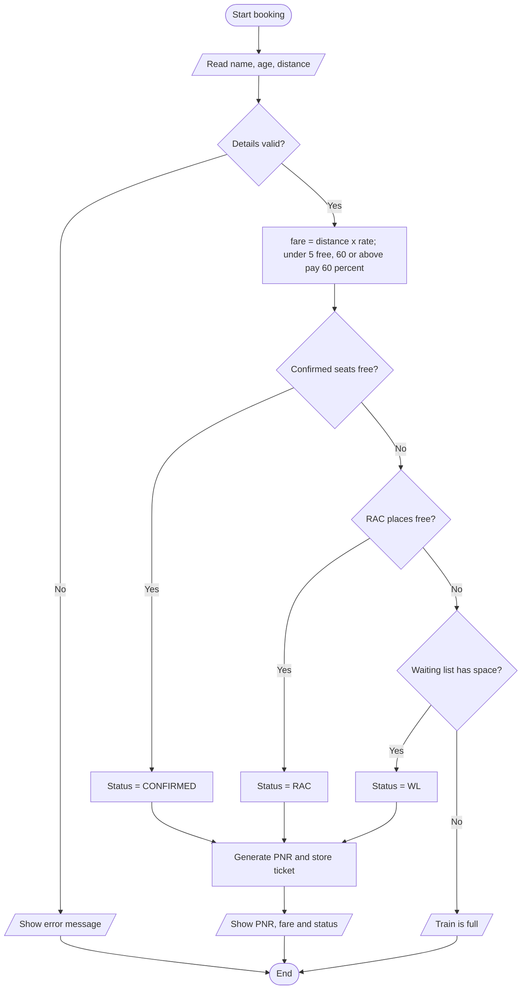
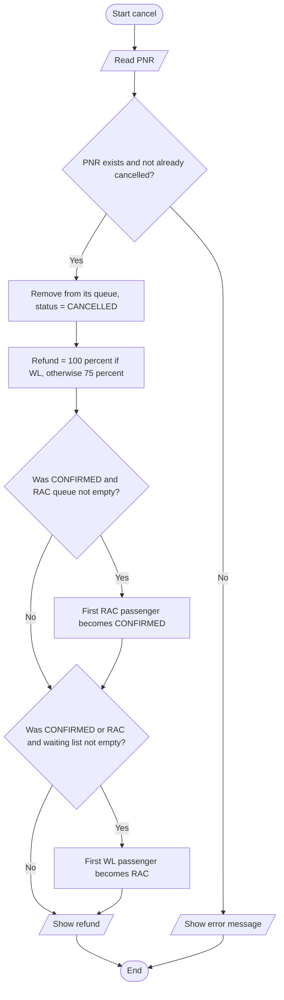

# Case Study 10: Railway Ticket Reservation System

> **Files:** [`railway_reservation.py`](railway_reservation.py) · [`test_railway_reservation.py`](test_railway_reservation.py) · [`output.txt`](output.txt)

## 1. Problem Statement

Design a ticket reservation system for one train. The train has a limited number of confirmed seats, then RAC (Reservation Against Cancellation) places, then a waiting list. A new booking gets the best status available. When a ticket is cancelled, passengers move up automatically (RAC to Confirmed, Waiting to RAC) and a refund is calculated. Fares depend on distance and passenger age.

## 2. Objectives

- Use classes, lists as queues (first come, first served) and dictionaries for tickets.
- Implement automatic promotion logic between three queues.
- Apply business rules for fares (child and senior concessions) and refunds.
- Generate unique PNR numbers and validate all inputs.

## 3. Assumptions

- One train; the capacity of each category is set when the train is created (demo: 2 confirmed, 1 RAC, 1 waiting).
- Fare = distance in km x rate per km (Rs. 1.5); children under 5 travel free; passengers aged 60 or more pay 60% of the fare.
- Refund is 75% of the fare for Confirmed/RAC tickets and 100% for a waiting-list ticket.
- PNR numbers start from 1001 and increase by 1; cancelled tickets stay in the record with status CANCELLED.
- One ticket per passenger; seat numbers are not allotted.

## 4. Algorithm

1. Start. Create the train with the three capacities and empty queues.
2. **Book:** validate name, age (0-120) and distance (> 0). Calculate the fare using the age rules.
3. Choose the first queue that has space in this order: CONFIRMED, RAC, WL. If none has space show "Train is full".
4. Create a PNR, store the ticket and add the PNR to the chosen queue.
5. **Cancel:** check the PNR exists and is not already cancelled. Remove it from its queue and set status CANCELLED. Refund = 100% if it was WL, else 75%.
6. If a CONFIRMED ticket was cancelled and the RAC queue is not empty, move the first RAC passenger to CONFIRMED.
7. If a CONFIRMED or RAC ticket was cancelled and the waiting list is not empty, move the first WL passenger to RAC.
8. **Status:** return the current status of a PNR. Repeat the menu until Exit. Stop.

## 5. Pseudocode

```text
FUNCTION book(name, age, distance)
    validate name, age, distance
    fare <- distance * rate
    IF age < 5 THEN fare <- 0 ELSE IF age >= 60 THEN fare <- fare * 0.60
    FOR EACH queue IN ["CONFIRMED", "RAC", "WL"]
        IF length(queues[queue]) < capacity[queue] THEN status <- queue; BREAK
    IF no status found THEN error "Train is full"
    create ticket with next PNR, fare, status; APPEND PNR TO queues[status]
    RETURN ticket
END FUNCTION

FUNCTION cancel(pnr)
    ticket <- tickets[pnr]  (error if missing or already cancelled)
    old <- ticket.status;  remove pnr from queues[old];  ticket.status <- "CANCELLED"
    refund <- fare * (1.00 IF old = "WL" ELSE 0.75)
    IF old = "CONFIRMED" AND RAC not empty THEN move first of RAC to CONFIRMED
    IF old IN ("CONFIRMED", "RAC") AND WL not empty THEN move first of WL to RAC
    RETURN refund
END FUNCTION
```

## 6. Flowchart

### 6.1 Book a ticket



### 6.2 Cancel a ticket



## 7. Source Code

The complete, commented program is in [`railway_reservation.py`](railway_reservation.py). It uses only the Python standard library (Python 3.8 or later).

```bash
python railway_reservation.py          # interactive menu / input
python railway_reservation.py --demo   # automatic sample run
```

## 8. Test Cases

Test file: `test_railway_reservation.py` (run `python test_railway_reservation.py` or add `--table` for this table).

| TC | Scenario / Input | Expected Output | Actual Output | Result |
|----|------------------|-----------------|---------------|--------|
| TC01 | Fare: adult (age 30), 400 km at Rs.1.5/km | `600.0` | `600.0` | PASS |
| TC02 | Fare: senior citizen (age 65) - 40% concession | `360.0` | `360.0` | PASS |
| TC03 | Fare: exactly age 60 gets concession | `360.0` | `360.0` | PASS |
| TC04 | Fare: child age 3 travels free | `0.0` | `0.0` | PASS |
| TC05 | Fare: age 5 pays full fare | `600.0` | `600.0` | PASS |
| TC06 | Status of four bookings in order | `['CONFIRMED', 'CONFIRMED', 'RAC', 'WL']` | `['CONFIRMED', 'CONFIRMED', 'RAC', 'WL']` | PASS |
| TC07 | First PNR number issued | `1001` | `1001` | PASS |
| TC08 | Fifth booking when train is full | `Error: Train is full - no booking possible` | `Error: Train is full - no booking possible` | PASS |
| TC09 | Cancel confirmed 1001: statuses of 1002, 1003, 1004 | `['CONFIRMED', 'CONFIRMED', 'RAC']` | `['CONFIRMED', 'CONFIRMED', 'RAC']` | PASS |
| TC10 | Cancel RAC 1003: statuses of 1001, 1002, 1004 | `['CONFIRMED', 'CONFIRMED', 'RAC']` | `['CONFIRMED', 'CONFIRMED', 'RAC']` | PASS |
| TC11 | Cancel waiting 1004: statuses of 1001, 1002, 1003 | `['CONFIRMED', 'CONFIRMED', 'RAC']` | `['CONFIRMED', 'CONFIRMED', 'RAC']` | PASS |
| TC12 | Refund for a confirmed ticket (75% of Rs.600) | `450.0` | `450.0` | PASS |
| TC13 | Refund for an RAC ticket (75% of Rs.600) | `450.0` | `450.0` | PASS |
| TC14 | Refund for a waiting-list ticket (100% of Rs.600) | `600.0` | `600.0` | PASS |
| TC15 | New booking after a cancellation frees the waiting list | `WL` | `WL` | PASS |
| TC16 | Cancel the same ticket twice | `Error: Ticket already cancelled` | `Error: Ticket already cancelled` | PASS |
| TC17 | Cancel unknown PNR | `Error: PNR not found` | `Error: PNR not found` | PASS |
| TC18 | Age 150 | `Error: Invalid age` | `Error: Invalid age` | PASS |
| TC19 | Blank passenger name | `Error: Passenger name cannot be empty` | `Error: Passenger name cannot be empty` | PASS |
| TC20 | Distance 0 km | `Error: Distance must be positive` | `Error: Distance must be positive` | PASS |

**Result: 20/20 test cases passed**

## 9. Output

Command: `python railway_reservation.py --demo`

```text
Booking tickets (2 confirmed, 1 RAC, 1 waiting)
  PNR 1001  Asha   age 30  fare Rs.600.0    CONFIRMED
  PNR 1002  Ravi   age 65  fare Rs.360.0    CONFIRMED
  PNR 1003  Meena  age 3   fare Rs.0.0      RAC
  PNR 1004  Kiran  age 40  fare Rs.600.0    WL
  Extra passenger -> Train is full - no booking possible

Cancelling PNR 1001 (Asha, confirmed)
  Refund: Rs. 450.0
  PNR 1002 is now CONFIRMED
  PNR 1003 is now CONFIRMED
  PNR 1004 is now RAC
```

<!-- Add your own terminal screenshot here:
 -->

## 10. Conclusion

The reservation system correctly assigns Confirmed, RAC and Waiting status, promotes passengers in the right order after cancellations and calculates fares and refunds using the stated rules. The 20 test cases cover every status transition, boundary ages (4, 5, 60) and all error conditions, and they pass. Using lists as first-come-first-served queues showed how a simple data structure models a real-world process.
